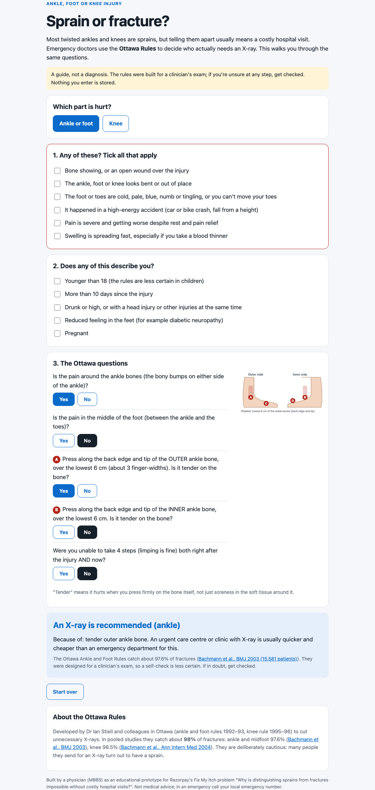

# Sprain or Fracture?

**Live: https://patelr31.github.io/sprain-check/** (GitHub Pages)

A guided self-check for ankle, foot and knee injuries. It uses the **Ottawa Rules**, the
decision rules emergency doctors use to decide who actually needs an X-ray.

It is built for Razorpay's [Fix My Itch](https://razorpay.com/m/fix-my-itch/) problem:
*"Why is distinguishing sprains from fractures impossible without costly hospital
visits?"*

**Who feels the pain:** anyone with a twisted ankle or knee, who faces an emergency visit
and X-ray costs to rule out a fracture. Most turn out to be sprains. **Who would pay:**
telehealth and urgent-care services that triage injuries, insurers trying to avoid
low-value ER visits, and sports and school clinics.

## How it works

The check runs in four steps, in this order:

1. **Warning signs first:** open wound, deformity, a cold or numb foot, a high-energy
   injury, severe or worsening pain, fast swelling on a blood thinner. Any of these
   means **go to emergency care now**.
2. **When the rules don't apply:** under 18, too long since the injury (more than 10 days
   for the ankle, 7 for the knee), drunk or high, a head injury or other injuries,
   reduced feeling, pregnancy. In those cases it says **see a clinician**.
3. **The Ottawa questions**, with a diagram of where to press:
   - **Ankle:** pain around the ankle bones, plus any of the following: tender back edge
     or tip of the outer ankle bone (A) or inner ankle bone (B), over the lowest 6 cm; or
     unable to take 4 steps both right after the injury and now.
   - **Foot:** pain in the midfoot, plus any of the following: tender base of the 5th
     metatarsal (C) or navicular (D); or unable to take 4 steps.
   - **Knee:** any of the following: age 55+, isolated kneecap tenderness, tender head of
     the fibula, can't bend to 90°, or unable to take 4 steps.
4. **Result:**
   - **X-ray recommended**, with the reasons and a pointer to urgent care, which is
     usually cheaper than the ER;
   - or **X-ray probably not needed**, with home care and when to get checked
     (still unable to bear weight, or no better after 5–7 days).

## Evidence

| Rule | Sensitivity | Specificity | Source |
|---|---|---|---|
| Ankle and midfoot | 97.6% | 31.5% | [Bachmann et al., BMJ 2003](https://pubmed.ncbi.nlm.nih.gov/12595378/), 27 studies, 15,581 patients |
| Knee | 98.5% | 48.6% | [Bachmann et al., Ann Intern Med 2004](https://pubmed.ncbi.nlm.nih.gov/14734335/), 6 studies, 4,249 adults |

The rules are deliberately cautious. They miss very few fractures, but many people they
send for an X-ray turn out to have a sprain. They were designed for a **clinician's
exam**, so the page says plainly that a self-check is less certain and to get checked if
in doubt.

## Tested paths

| Case | Result |
|---|---|
| Ankle, all criteria negative | No X-ray needed (home care) |
| Ankle, outer ankle bone tender | Ankle X-ray |
| Midfoot, 5th metatarsal base tender | Foot X-ray |
| Pain outside both zones | See a clinician (the rules don't cover it) |
| Deformity | Emergency care now |
| Knee injury more than 7 days old | See a clinician |
| Knee, all criteria negative | No X-ray needed |
| Age 55+ | Knee X-ray |

## Run it

It is a static site: `rules.js` holds the criteria, warning signs and evidence, and
`app.js` the logic and diagrams. Nothing is stored or sent.

Not medical advice. Built by a physician (MBBS) as part of a personal "vibe coding"
practice roadmap (Real problems track, #5).
